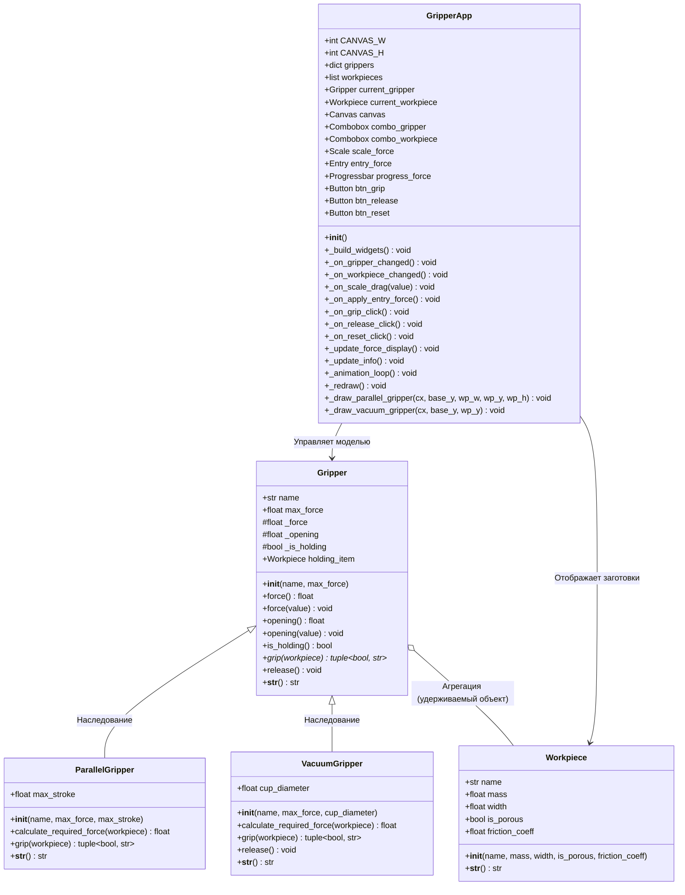
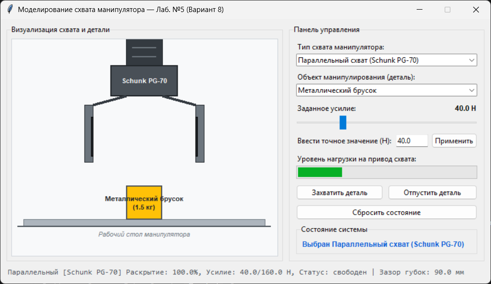
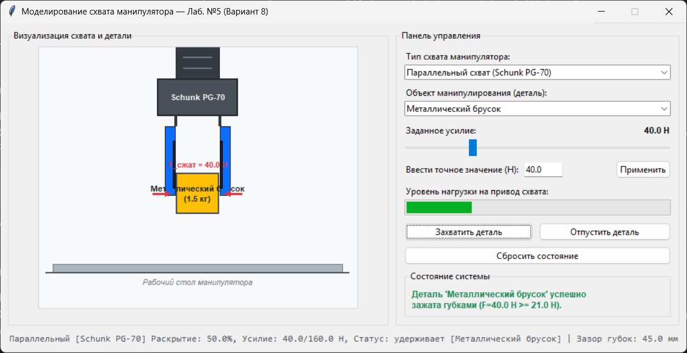
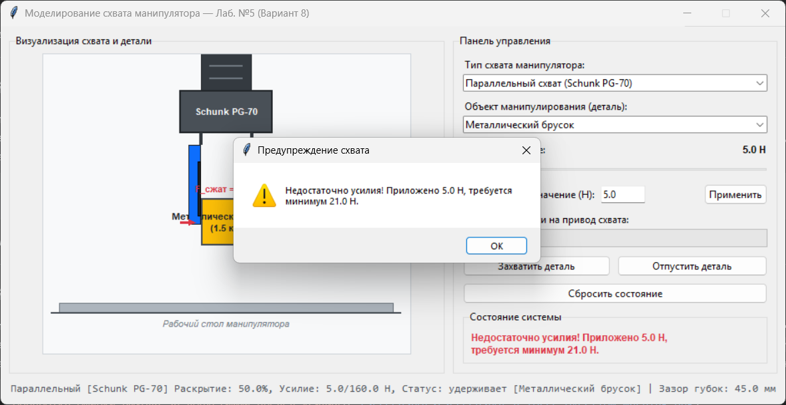
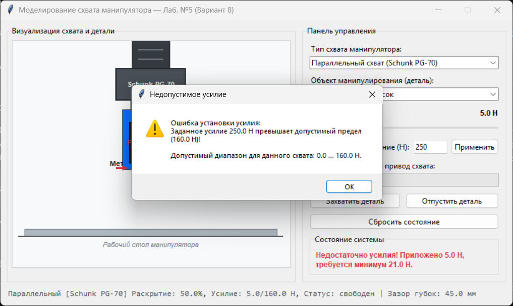
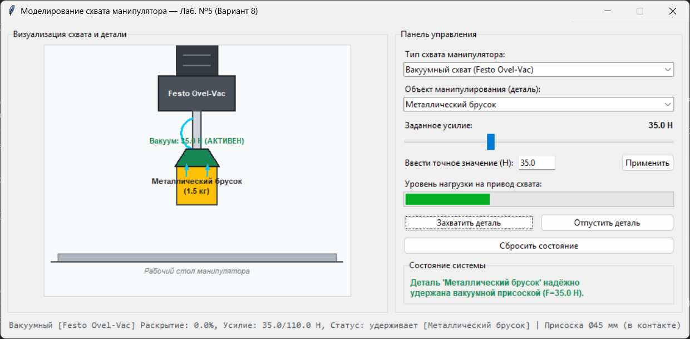
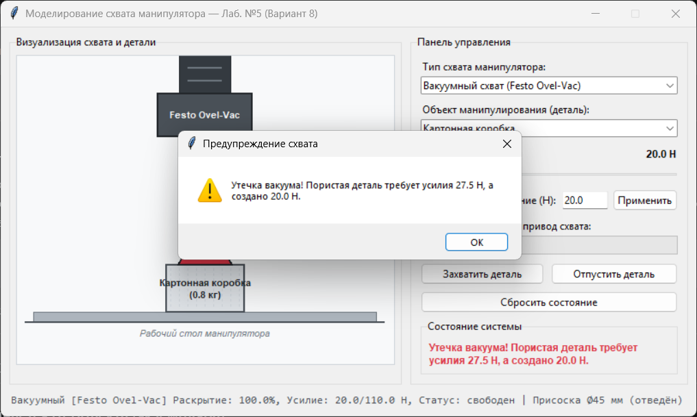

# Федеральное государственное автономное образовательное учреждение высшего образования
## «Омский государственный технический университет»
### Кафедра «Автоматизация и робототехника»

---

<br>

<div align="center">

# ОТЧЕТ
### По лабораторной работе №5
**«Объектно-ориентированное программирование (ООП) в приложении с оконным интерфейсом»**

**Вариант №8: «Схват манипулятора»**

**Дисциплина:** Программирование на языке Python

</div>

<br>

---

| Сведения об авторе | Сведения о проверяющем |
| :--- | :--- |
| **Выполнил:** | **Проверил:** |
| Студент группы УТС-251т | Доцент, к.т.н. |
| Коньшунов Денис Игоревич | Ситников Дмитрий Владимирович |
| | |
| | Подпись: \_\_\_\_\_\_\_\_\_\_\_\_\_\_\_\_\_\_\_\_\_ |
| | «\_\_\_» \_\_\_\_\_\_\_\_ 20\_\_ г. |

<br>

<div align="center">

**г. Омск, 2026 г.**

</div>

---

## 1. Цель работы

Изучить фундаментальные концепции объектно-ориентированного программирования (ООП) в языке Python: проектирование классов, принципы инкапсуляции, наследования и полиморфизма. Получить практические навыки разработки настольного приложения с графическим интерфейсом пользователя (GUI) на базе стандартной библиотеки Tkinter/ttk для имитационного моделирования и визуального контроля мехатронного объекта (схвата промышленного робота-манипулятора).

---

## 2. Краткие теоретические сведения

### 2.1. Основные концепции объектно-ориентированного программирования (ООП)
* **Класс и объект:** Класс представляет собой пользовательский тип данных и шаблон, определяющий состав полей (атрибутов состояния) и функций (методов поведения). Экземпляр (объект) создается вызовом класса. Специальный метод `__init__(self, ...)` является конструктором экземпляра и инициализирует его начальные поля. Ссылка `self` передается первым аргументом во все методы экземпляра и указывает на конкретный объект в памяти.
* **Инкапсуляция и свойства (`@property`):** Инкапсуляция заключается в сокрытии внутреннего представления объекта и защите критических данных от несанкционированного изменения. В Python соглашением о защищенных атрибутах является префикс с одним подчеркиванием (`_attribute`). Декораторы `@property` и `@<name>.setter` позволяют определить интерфейс свойств (геттеры и сеттеры) для прозрачного чтения и контролируемой записи данных с автоматической валидацией допустимых значений (например, отсечение отрицательных чисел или проверка превышения предельных нагрузок с генерацией `ValueError`).
* **Наследование и делегирование (`super()`):** Механизм наследования позволяет порождать новые классы на основе существующих, расширяя их возможности и исключая дублирование исходного кода. Встроенная функция `super()` возвращает прокси-объект, делегирующий вызовы методов родительскому классу в соответствии с порядком разрешения методов (Method Resolution Order, MRO). В конструкторах классов-потомков вызов `super().__init__(...)` обеспечивает корректную инициализацию базовых атрибутов.
* **Полиморфизм:** Принцип полиморфизма заключается в способности объектов различных классов предоставлять единообразный программный интерфейс при различной внутренней реализации. Вызывающий код обращается к общему имени метода (например, `gripper.grip(target)`), а фактический алгоритм исполнения определяется типом экземпляра (`ParallelGripper` или `VacuumGripper`).
* **Строковое представление (`__str__` и `__repr__`):** Метод `__str__` возвращает человекочитаемое строковое описание объекта, используемое функциями `print()` и `str()`, тогда как `__repr__` служит для однозначного технического описания объекта при отладке.

### 2.2. Архитектура оконного приложения на Tkinter
* **Разделение логики модели и графического интерфейса (GUI):** Модель предметной области (классы `Gripper`, `ParallelGripper`, `VacuumGripper`, `Workpiece`) проектируется в виде независимых структур данных и математических соотношений без привязки к оконной подсистеме. Класс окна (`GripperApp`) наследуется от `tk.Tk`, инкапсулирует виджеты и делегирует команды объектам модели.
* **Цикл событий `mainloop()` и неблокирующая анимация:** Tkinter функционирует на основе управляемого событиями цикла `mainloop()`. Использование блокирующих задержек `time.sleep()` в обработчиках недопустимо, так как это замораживает обработку сообщений операционной системы. Периодические вычисления и плавная анимация реализуются с помощью метода `after(ms, callback)`.
* **Виджеты графического интерфейса:**
  * `tk.Canvas` — холст для двумерной векторной визуализации кинематики схвата, положения деталей, контактных поверхностей и векторов усилий;
  * `ttk.Combobox` — выпадающий список для переключения типов схватов и тестируемых заготовок;
  * `ttk.Scale` — ползунок непрерывного регулирования задаваемого усилия;
  * `ttk.Entry` — поле ввода точных числовых значений с обработкой исключений `try...except`;
  * `ttk.Progressbar` — шкала процентной загрузки исполнительного привода схвата;
  * `ttk.Button` — командные кнопки («Захватить», «Отпустить», «Сброс»);
  * `ttk.Label` / `ttk.LabelFrame` — текстовые метки и группирующие рамки.

---

## 3. Индивидуальное задание (Вариант №8)

**Тема:** «Схват манипулятора»

### Формулировка задания:
1. Разработать классы модели:
   * `Gripper` — базовый класс схвата манипулятора (усилие, степень раскрытия, флаг удержания детали);
   * `ParallelGripper` — механический двухпальцевый параллельный схват с проверкой геометрического раскрытия и расчетом усилия трения покоя $F_{тр} = 2 \mu F_{сжат}$;
   * `VacuumGripper` — вакуумный схват с присоской, учитывающий утечки разрежения на пористых поверхностях;
   * `Workpiece` — объект манипулирования (деталь с массой, габаритом и фактурой поверхности).
2. Реализовать графический интерфейс приложения со следующими элементами:
   * выбор типа схвата (`Combobox`);
   * выбор параметров манипулируемой детали;
   * задание прикладываемого усилия ползунком (`Scale`) и числовым полем (`Entry`);
   * кнопки «Захватить деталь», «Отпустить деталь», «Сбросить состояние»;
   * индикатор нагрузки привода (`Progressbar`);
   * интерактивный холст (`Canvas`) с графической визуализацией корпуса схвата, кинематики губок/присоски, детали и контактных сил;
   * обработка некорректных значений и аварийных ситуаций: при превышении допустимого усилия схвата выводить предупреждающее диалоговое окно (`messagebox.showwarning`), при недостаточном усилии или геометрическом несоответствии фиксировать срыв захвата.

---

## 4. Диаграмма классов

Ниже представлена структура спроектированных классов, их атрибуты, методы и взаимосвязи наследования:



---

## 5. Макет окна приложения и используемые виджеты

Интерфейс спроектирован по двухколоночной компоновке на базе менеджера `grid`:

```text
+---------------------------------------------------------------------------------+
| Моделирование схвата манипулятора — Лаб. №5 (Вариант 8)                         |
+------------------------------------+--------------------------------------------+
|  Холст визуализации (tk.Canvas)    |  Панель управления (ttk.LabelFrame)        |
|                                    |  - Тип схвата: [ Combobox                ] |
|   [Фланец манипулятора]            |  - Деталь:     [ Combobox                ] |
|   [Корпус схвата]                  |  - Усилие:     [=== Scale ==========] 40 Н |
|   [Губки / Присоска]               |    Точный ввод: [ Entry ] [ Применить ]    |
|   [Деталь (Workpiece)]             |  - Нагрузка привода: [==== Progressbar ===]|
|   [Векторы сил прижима]            |  - [ Захватить деталь ] [ Отпустить деталь]|
|                                    |  - [ Сбросить состояние ]                  |
|   [Рабочий стол манипулятора]      |  - Статус: "Готов к работе" (Label)        |
+------------------------------------+--------------------------------------------+
|  Строка состояния модели: [Schunk PG-70] Раскрытие: 100%, Усилие: 40 Н...       |
+---------------------------------------------------------------------------------+
```

### Перечень используемых виджетов библиотеки Tkinter/ttk:
1. `tk.Tk` — главное окно программы, задает контейнер верхнего уровня;
2. `tk.Canvas` — холст размером $440 \times 360$ пикселей с плавным перерисовыванием элементов сцены (механическая рука, рабочий стол, детали, подвижные пальцы схвата, вакуумный телескопический шток, резиновая присоска, силовые стрелки контактов);
3. `ttk.LabelFrame` — визуальные рамки-контейнеры для логической группировки управляющих элементов и области графики;
4. `ttk.Combobox` — два раскрывающихся списка:
   - выбор типа рабочего органа («Параллельный схват Schunk PG-70» или «Вакуумный схват Festo Ovel-Vac»);
   - выбор манипулируемой детали с различными параметрами массы, габарита и пористости поверхности;
5. `ttk.Scale` — горизонтальный слайдер задания непрерывного усилия прижима;
6. `ttk.Entry` — поле прямого клавиатурного ввода значения силы в ньютонах;
7. `ttk.Button` — командные кнопки для инициирования действий: «Захватить деталь», «Отпустить деталь», «Применить» и «Сбросить состояние»;
8. `ttk.Progressbar` — индикатор коэффициента загрузки сервопривода/пневмосистемы схвата ($0 \dots 100\,\%$);
9. `ttk.Label` — текстовые индикаторы числовых значений, текстовый журнал статуса и нижняя строка параметров модели.

---

## 6. Листинг программы

Ниже приведен полный исходный код файла `main.py`:

```python
"""Лабораторная работа №5.
Тема: Объектно-ориентированное программирование (ООП) в приложении с оконным интерфейсом.
Вариант 8. Схват манипулятора.

Классы модели:
  - Gripper (базовый класс схвата манипулятора)
  - ParallelGripper (наследник: двухпальцевый параллельный схват)
  - VacuumGripper (наследник: вакуумный схват с присоской)
  - Workpiece (модель захватываемой детали)

Класс графического интерфейса:
  - GripperApp (окно приложения на Tkinter)
"""

import math
import tkinter as tk
from tkinter import messagebox, ttk


# ============================================================================
# 1. КЛАССЫ МОДЕЛИ ПРЕДМЕТНОЙ ОБЛАСТИ (не импортируют и не зависят от Tkinter)
# ============================================================================

class Workpiece:
    """Модель захватываемой детали (объекта манипулирования).

    Атрибуты:
        name (str): наименование детали.
        mass (float): масса детали, кг.
        width (float): ширина / характерный размер детали, мм.
        is_porous (bool): пористость поверхности (True - пористая, False - гладкая/воздухонепроницаемая).
        friction_coeff (float): коэффициент трения между деталью и губками схвата.
    """

    def __init__(
        self,
        name: str,
        mass: float = 1.0,
        width: float = 60.0,
        is_porous: bool = False,
        friction_coeff: float = 0.35,
    ) -> None:
        self.name = name
        self.mass = mass
        self.width = width
        self.is_porous = is_porous
        self.friction_coeff = friction_coeff

    def __str__(self) -> str:
        surf = "пористая" if self.is_porous else "гладкая"
        return f"{self.name} (масса: {self.mass:.2f} кг, ширина: {self.width:.0f} мм, пов.: {surf})"


class Gripper:
    """Базовый класс модели схвата промышленного манипулятора.

    Демонстрирует инкапсуляцию через свойства @property для усилия и степени раскрытия,
    а также базовый интерфейс для захвата и отпускания деталей.

    Атрибуты:
        name (str): наименование/модель схвата.
        max_force (float): предельно допустимое рабочее усилие, Н.
        _force (float): текущее приложенное усилие, Н (инкапсулировано).
        _opening (float): степень раскрытия схвата от 0.0 (полностью закрыт) до 1.0 (раскрыт).
        _is_holding (bool): состояние захвата детали (True - удерживает).
        holding_item (Workpiece | None): текущая удерживаемая деталь.
    """

    def __init__(self, name: str, max_force: float = 120.0) -> None:
        """Инициализация базового схвата."""
        self.name = name
        self.max_force = float(max_force)
        self._force = 0.0
        self._opening = 1.0  # по умолчанию схват открыт
        self._is_holding = False
        self.holding_item: Workpiece | None = None

    # --- Инкапсуляция: свойство force ---
    @property
    def force(self) -> float:
        """Текущее развиваемое усилие схвата, Н."""
        return self._force

    @force.setter
    def force(self, value: float) -> None:
        """Установка усилия схвата с валидацией допустимого диапазона."""
        val = float(value)
        if val < 0.0:
            raise ValueError("Усилие схвата не может быть отрицательным!")
        if val > self.max_force:
            raise ValueError(
                f"Заданное усилие {val:.1f} Н превышает допустимый предел ({self.max_force:.1f} Н)!"
            )
        self._force = val

    # --- Инкапсуляция: свойство opening ---
    @property
    def opening(self) -> float:
        """Степень раскрытия схвата (от 0.0 до 1.0)."""
        return self._opening

    @opening.setter
    def opening(self, value: float) -> None:
        """Установка степени раскрытия схвата с проверкой диапазона."""
        val = float(value)
        if not (0.0 <= val <= 1.0):
            raise ValueError("Степень раскрытия должна находиться в диапазоне [0.0; 1.0]!")
        self._opening = val

    @property
    def is_holding(self) -> bool:
        """Флаг успешного удержания детали."""
        return self._is_holding

    def grip(self, workpiece: Workpiece) -> tuple[bool, str]:
        """Базовый метод захвата детали (переопределяется в подклассах).

        Возвращает:
            tuple[bool, str]: (успех захвата, текстовое пояснение).
        """
        raise NotImplementedError("Метод grip должен быть реализован в производном классе.")

    def release(self) -> None:
        """Отпускание детали и возврат схвата в исходное открытое положение."""
        self._is_holding = False
        self.holding_item = None
        self._opening = 1.0

    def __str__(self) -> str:
        status = f"удерживает [{self.holding_item.name}]" if self._is_holding else "свободен"
        return (
            f"[{self.name}] Раскрытие: {self._opening * 100:.1f}%, "
            f"Усилие: {self._force:.1f}/{self.max_force:.1f} Н, Статус: {status}"
        )


class ParallelGripper(Gripper):
    """Двухпальцевый параллельный механический схват.

    Наследует Gripper. Особенности логики захвата:
    - Механическое смыкание губок до ширины детали.
    - Удержание за счёт силы сухого трения покоя: F_тр = 2 * mu * F_сжат.
      Для удержания вертикальной детали требуется: F_сжат >= (m * g) / (2 * mu).
    - При чрезмерном сжатии деталь может быть повреждена (хрупкость).
    """

    def __init__(
        self,
        name: str = "Schunk PG-70",
        max_force: float = 150.0,
        max_stroke: float = 100.0,
    ) -> None:
        """Инициализация параллельного схвата через super().

        Параметры:
            max_stroke (float): максимальный ход раскрытия губок, мм.
        """
        super().__init__(name=name, max_force=max_force)
        self.max_stroke = float(max_stroke)

    def calculate_required_force(self, workpiece: Workpiece) -> float:
        """Расчёт минимально необходимого усилия сжатия для удержания детали."""
        g = 9.81
        weight = workpiece.mass * g
        friction = max(workpiece.friction_coeff, 0.05)
        # Двухпальцевый охват (две поверхности контакта): F_сжат >= weight / (2 * mu)
        return weight / (2.0 * friction)

    def grip(self, workpiece: Workpiece) -> tuple[bool, str]:
        """Полиморфная реализация захвата для параллельного механического схвата."""
        if workpiece.width > self.max_stroke:
            self._is_holding = False
            self.holding_item = None
            return False, f"Ширина детали ({workpiece.width:.0f} мм) превышает ход губок ({self.max_stroke:.0f} мм)!"

        # Смыкаем пальцы до размера детали
        self.opening = workpiece.width / self.max_stroke

        req_force = self.calculate_required_force(workpiece)
        if self.force < req_force:
            self._is_holding = False
            self.holding_item = None
            return (
                False,
                f"Недостаточно усилия! Приложено {self.force:.1f} Н, требуется минимум {req_force:.1f} Н.",
            )

        self._is_holding = True
        self.holding_item = workpiece
        return (
            True,
            f"Деталь '{workpiece.name}' успешно зажата губками (F={self.force:.1f} Н >= {req_force:.1f} Н).",
        )

    def __str__(self) -> str:
        base_info = super().__str__()
        gap = self.opening * self.max_stroke
        return f"Параллельный {base_info} | Зазор губок: {gap:.1f} мм"


class VacuumGripper(Gripper):
    """Вакуумный схват с эластичной присоской.

    Наследует Gripper. Особенности логики захвата:
    - Нет подвижных пальцев: степень раскрытия отражает контактную фазу прижатия присоски (0 - прижата, 1 - отведена).
    - Удержание за счёт разрежения вакуума. На пористых/неровных материалах (дерево, картон)
      происходит утечка воздуха, поэтому требуется повышенное усилие прижима/вакуума или захват невозможен.
    - Сила удержания: F_уд = Delta_P * S_присоски. Для удержания требуется F_прижима >= m * g * k_запаса.
    """

    def __init__(
        self,
        name: str = "Festo Ovel-Vac",
        max_force: float = 100.0,
        cup_diameter: float = 40.0,
    ) -> None:
        """Инициализация вакуумного схвата через super().

        Параметры:
            cup_diameter (float): диаметр вакуумной присоски, мм.
        """
        super().__init__(name=name, max_force=max_force)
        self.cup_diameter = float(cup_diameter)

    def calculate_required_force(self, workpiece: Workpiece) -> float:
        """Расчёт требуемого вакуумного усилия с учётом пористости материала."""
        g = 9.81
        weight = workpiece.mass * g
        # Для гладких поверхностей коэффициент запаса 1.5, для пористых — 3.5 из-за утечек
        safety_factor = 3.5 if workpiece.is_porous else 1.5
        return weight * safety_factor

    def grip(self, workpiece: Workpiece) -> tuple[bool, str]:
        """Полиморфная реализация захвата для вакуумного схвата."""
        req_force = self.calculate_required_force(workpiece)

        # Присоска опускается вплотную к детали
        self.opening = 0.0

        if workpiece.is_porous and self.force < req_force:
            self._is_holding = False
            self.holding_item = None
            return (
                False,
                f"Утечка вакуума! Пористая деталь требует усилия {req_force:.1f} Н, а создано {self.force:.1f} Н.",
            )

        if self.force < req_force:
            self._is_holding = False
            self.holding_item = None
            return (
                False,
                f"Недостаточное разрежение вакуума! Требуется {req_force:.1f} Н, создано {self.force:.1f} Н.",
            )

        self._is_holding = True
        self.holding_item = workpiece
        return (
            True,
            f"Деталь '{workpiece.name}' надёжно удержана вакуумной присоской (F={self.force:.1f} Н).",
        )

    def release(self) -> None:
        """Сброс вакуума и продувка."""
        super().release()

    def __str__(self) -> str:
        base_info = super().__str__()
        contact = "в контакте" if self.opening < 0.1 else "отведён"
        return f"Вакуумный {base_info} | Присоска Ø{self.cup_diameter:.0f} мм ({contact})"


# ============================================================================
# 2. ГРАФИЧЕСКИЙ ИНТЕРФЕЙС ПРИЛОЖЕНИЯ (Tkinter / ttk)
# ============================================================================

class GripperApp(tk.Tk):
    """Главное окно приложения моделирования схвата манипулятора.

    Отделено от логики классов модели, взаимодействует с ними через публичный интерфейс.
    """

    CANVAS_W = 440
    CANVAS_H = 360

    def __init__(self) -> None:
        super().__init__()
        self.title("Моделирование схвата манипулятора — Лаб. №5 (Вариант 8)")
        self.resizable(False, False)

        # Предустановленные модели схватов
        self.grippers = {
            "Параллельный схват (Schunk PG-70)": ParallelGripper("Schunk PG-70", max_force=160.0, max_stroke=90.0),
            "Вакуумный схват (Festo Ovel-Vac)": VacuumGripper("Festo Ovel-Vac", max_force=110.0, cup_diameter=45.0),
        }
        self.current_gripper: Gripper = self.grippers["Параллельный схват (Schunk PG-70)"]

        # Набор тестовых деталей
        self.workpieces = [
            Workpiece("Металлический брусок", mass=1.5, width=45.0, is_porous=False, friction_coeff=0.35),
            Workpiece("Картонная коробка", mass=0.8, width=70.0, is_porous=True, friction_coeff=0.45),
            Workpiece("Тяжёлый стальной фланец", mass=4.5, width=65.0, is_porous=False, friction_coeff=0.25),
            Workpiece("Пластиковый цилиндр", mass=0.5, width=30.0, is_porous=False, friction_coeff=0.30),
        ]
        self.current_workpiece: Workpiece = self.workpieces[0]

        # Связанные переменные интерфейса
        self.gripper_type_var = tk.StringVar(value=list(self.grippers.keys())[0])
        self.workpiece_var = tk.StringVar(value=self.workpieces[0].name)
        self.force_var = tk.DoubleVar(value=40.0)
        self.status_var = tk.StringVar(value="Готов к работе")
        self.info_var = tk.StringVar(value="")

        # Переменные плавной анимации губок/присоски
        self.animated_opening = self.current_gripper.opening
        self.target_opening = self.current_gripper.opening

        self._build_widgets()
        self._on_gripper_changed()
        self._update_info()
        self._redraw()
        self._animation_loop()

    def _build_widgets(self) -> None:
        """Создание и компоновка виджетов интерфейса."""
        root_container = ttk.Frame(self, padding=10)
        root_container.pack(fill="both", expand=True)

        # Левая часть: холст Canvas для графической визуализации
        canvas_frame = ttk.LabelFrame(root_container, text="Визуализация схвата и детали", padding=6)
        canvas_frame.grid(row=0, column=0, rowspan=2, padx=(0, 10), sticky="nsew")

        self.canvas = tk.Canvas(
            canvas_frame,
            width=self.CANVAS_W,
            height=self.CANVAS_H,
            bg="#f8f9fa",
            highlightthickness=1,
            highlightbackground="#ced4da",
        )
        self.canvas.pack()

        # Правая часть: панель управления и настроек
        ctrl_frame = ttk.LabelFrame(root_container, text="Панель управления", padding=10)
        ctrl_frame.grid(row=0, column=1, sticky="nsew")

        # 1. Выбор типа схвата (ttk.Combobox)
        ttk.Label(ctrl_frame, text="Тип схвата манипулятора:").pack(anchor="w")
        self.combo_gripper = ttk.Combobox(
            ctrl_frame,
            textvariable=self.gripper_type_var,
            values=list(self.grippers.keys()),
            state="readonly",
            width=36,
        )
        self.combo_gripper.pack(fill="x", pady=(2, 8))
        self.combo_gripper.bind("<<ComboboxSelected>>", lambda e: self._on_gripper_changed())

        # 2. Выбор детали (ttk.Combobox)
        ttk.Label(ctrl_frame, text="Объект манипулирования (деталь):").pack(anchor="w")
        self.combo_workpiece = ttk.Combobox(
            ctrl_frame,
            textvariable=self.workpiece_var,
            values=[wp.name for wp in self.workpieces],
            state="readonly",
            width=36,
        )
        self.combo_workpiece.pack(fill="x", pady=(2, 8))
        self.combo_workpiece.bind("<<ComboboxSelected>>", lambda e: self._on_workpiece_changed())

        # 3. Ползунок и ввод усилия (ttk.Scale, ttk.Entry)
        force_header = ttk.Frame(ctrl_frame)
        force_header.pack(fill="x", pady=(2, 0))
        ttk.Label(force_header, text="Заданное усилие:").pack(side="left")
        self.lbl_force_val = ttk.Label(force_header, text="40.0 Н", font=("Arial", 9, "bold"))
        self.lbl_force_val.pack(side="right")

        self.scale_force = ttk.Scale(
            ctrl_frame,
            from_=0.0,
            to=self.current_gripper.max_force,
            orient="horizontal",
            variable=self.force_var,
            command=self._on_scale_drag,
        )
        self.scale_force.pack(fill="x", pady=2)

        # Ручной ввод усилия для демонстрации try/except и проверки выхода за пределы
        manual_frame = ttk.Frame(ctrl_frame)
        manual_frame.pack(fill="x", pady=(2, 8))
        ttk.Label(manual_frame, text="Ввести точное значение (Н):").pack(side="left")
        self.entry_force = ttk.Entry(manual_frame, width=8)
        self.entry_force.pack(side="left", padx=5)
        self.entry_force.insert(0, "40.0")
        btn_apply_force = ttk.Button(manual_frame, text="Применить", command=self._on_apply_entry_force)
        btn_apply_force.pack(side="right")

        # 4. Индикатор нагрузки / усилия (ttk.Progressbar)
        ttk.Label(ctrl_frame, text="Уровень нагрузки на привод схвата:").pack(anchor="w")
        self.progress_force = ttk.Progressbar(ctrl_frame, maximum=100.0, mode="determinate")
        self.progress_force.pack(fill="x", pady=(2, 10))

        # 5. Кнопки управления операциями
        btn_grid = ttk.Frame(ctrl_frame)
        btn_grid.pack(fill="x", pady=(0, 8))
        self.btn_grip = ttk.Button(btn_grid, text="Захватить деталь", command=self._on_grip_click)
        self.btn_grip.pack(side="left", expand=True, fill="x", padx=(0, 4))
        self.btn_release = ttk.Button(btn_grid, text="Отпустить деталь", command=self._on_release_click)
        self.btn_release.pack(side="right", expand=True, fill="x", padx=(4, 0))

        # Кнопка сброса
        self.btn_reset = ttk.Button(ctrl_frame, text="Сбросить состояние", command=self._on_reset_click)
        self.btn_reset.pack(fill="x", pady=(0, 8))

        # 6. Текстовый статус и панель информации (ttk.Label)
        status_box = ttk.LabelFrame(ctrl_frame, text="Состояние системы", padding=6)
        status_box.pack(fill="x")
        self.lbl_status = ttk.Label(
            status_box,
            textvariable=self.status_var,
            wraplength=270,
            foreground="#0b5ed7",
            font=("Arial", 9, "bold"),
        )
        self.lbl_status.pack(anchor="w")

        # Нижняя строка окна: параметры модели (__str__)
        info_frame = ttk.Frame(root_container, padding=(0, 8, 0, 0))
        info_frame.grid(row=2, column=0, columnspan=2, sticky="ew")
        self.lbl_model_str = ttk.Label(
            info_frame,
            textvariable=self.info_var,
            font=("Consolas", 9),
            foreground="#495057",
        )
        self.lbl_model_str.pack(anchor="w")

    # --- Обработчики событий ---

    def _on_gripper_changed(self) -> None:
        """Переключение типа схвата через выпадающий список."""
        selected_name = self.gripper_type_var.get()
        self.current_gripper = self.grippers[selected_name]

        # Настраиваем пределы ползунка под выбранный тип схвата
        self.scale_force.config(to=self.current_gripper.max_force)

        # Синхронизируем усилие через безопасный сеттер
        try:
            cur_val = min(self.force_var.get(), self.current_gripper.max_force)
            self.current_gripper.force = cur_val
            self.force_var.set(cur_val)
        except ValueError as err:
            messagebox.showerror("Ошибка параметров схвата", str(err))

        self.current_gripper.release()
        self.target_opening = self.current_gripper.opening
        self.animated_opening = self.target_opening
        self.status_var.set(f"Выбран {selected_name}")
        self._update_force_display()
        self._update_info()
        self._redraw()

    def _on_workpiece_changed(self) -> None:
        """Смена активной детали."""
        selected_name = self.workpiece_var.get()
        for wp in self.workpieces:
            if wp.name == selected_name:
                self.current_workpiece = wp
                break
        self.current_gripper.release()
        self.target_opening = self.current_gripper.opening
        self.status_var.set(f"Выбрана деталь: {self.current_workpiece.name}")
        self._update_info()
        self._redraw()

    def _on_scale_drag(self, value: str) -> None:
        """Обработка перемещения ползунка усилия."""
        try:
            val = float(value)
            self.current_gripper.force = val
            self._update_force_display()
            self._update_info()
            self._redraw()
        except ValueError as err:
            messagebox.showerror("Ошибка задания усилия", str(err))

    def _on_apply_entry_force(self) -> None:
        """Обработка прямого ввода усилия в поле Entry с проверкой try/except."""
        raw_text = self.entry_force.get().strip()
        try:
            val = float(raw_text)
            # При присвоении срабатывает @force.setter с проверкой диапазона
            self.current_gripper.force = val
            self.force_var.set(val)
            self._update_force_display()
            self._update_info()
            self._redraw()
            self.status_var.set(f"Установлено усилие {val:.1f} Н")
        except ValueError as err:
            # Предупреждение при выходе за допустимый диапазон или нечисловом вводе
            messagebox.showwarning(
                "Недопустимое усилие",
                f"Ошибка установки усилия:\n{err}\n\n"
                f"Допустимый диапазон для данного схвата: 0.0 ... {self.current_gripper.max_force:.1f} Н.",
            )
            # Возвращаем текущее корректное значение
            self.entry_force.delete(0, tk.END)
            self.entry_force.insert(0, f"{self.current_gripper.force:.1f}")

    def _on_grip_click(self) -> None:
        """Обработка нажатия кнопки 'Захватить деталь'."""
        try:
            success, message = self.current_gripper.grip(self.current_workpiece)
            self.target_opening = self.current_gripper.opening
            if success:
                self.status_var.set(message)
                self.lbl_status.config(foreground="#198754")  # зелёный
            else:
                self.status_var.set(message)
                self.lbl_status.config(foreground="#dc3545")  # красный
                messagebox.showwarning("Предупреждение схвата", message)
            self._update_info()
        except ValueError as err:
            messagebox.showerror("Критическая ошибка схвата", str(err))

    def _on_release_click(self) -> None:
        """Обработка нажатия кнопки 'Отпустить деталь'."""
        self.current_gripper.release()
        self.target_opening = self.current_gripper.opening
        self.status_var.set("Деталь отпущена. Схват в исходном положении.")
        self.lbl_status.config(foreground="#0b5ed7")
        self._update_info()

    def _on_reset_click(self) -> None:
        """Сброс всех параметров к исходным."""
        self.current_gripper.release()
        self.current_gripper.force = 40.0
        self.force_var.set(40.0)
        self.target_opening = 1.0
        self.animated_opening = 1.0
        self.status_var.set("Состояние успешно сброшено.")
        self.lbl_status.config(foreground="#0b5ed7")
        self._update_force_display()
        self._update_info()
        self._redraw()

    def _update_force_display(self) -> None:
        """Обновление текстового значения и шкалы Progressbar."""
        f_val = self.current_gripper.force
        self.lbl_force_val.config(text=f"{f_val:.1f} Н")
        pct = (f_val / self.current_gripper.max_force) * 100.0
        self.progress_force["value"] = pct

        self.entry_force.delete(0, tk.END)
        self.entry_force.insert(0, f"{f_val:.1f}")

    def _update_info(self) -> None:
        """Обновление нижней строки с демонстрацией метода __str__."""
        self.info_var.set(str(self.current_gripper))

    # --- Плавная анимация и таймер after() ---

    def _animation_loop(self) -> None:
        """Плавная интерполяция движения губок или штока схвата."""
        diff = self.target_opening - self.animated_opening
        if abs(diff) > 0.02:
            self.animated_opening += diff * 0.25
            self._redraw()
        elif self.animated_opening != self.target_opening:
            self.animated_opening = self.target_opening
            self._redraw()

        self.after(30, self._animation_loop)

    # --- Отрисовка на Canvas ---

    def _redraw(self) -> None:
        """Полная перерисовка графической сцены на холсте Canvas."""
        cv = self.canvas
        cv.delete("all")

        w = self.CANVAS_W
        h = self.CANVAS_H
        cx = w / 2

        # 1. Отрисовка рабочего стола / подставки
        table_y = h - 60
        cv.create_rectangle(20, table_y, w - 20, table_y + 12, fill="#adb5bd", outline="#6c757d")
        cv.create_line(10, table_y + 12, w - 10, table_y + 12, fill="#495057", width=2)
        cv.create_text(
            cx,
            table_y + 25,
            text="Рабочий стол манипулятора",
            font=("Arial", 8, "italic"),
            fill="#6c757d",
        )

        # 2. Отрисовка фланца манипулятора (рука сверху)
        cv.create_rectangle(cx - 30, 0, cx + 30, 45, fill="#343a40", outline="#212529")
        cv.create_line(cx - 20, 15, cx + 20, 15, fill="#6c757d", width=2)
        cv.create_line(cx - 20, 30, cx + 20, 30, fill="#6c757d", width=2)

        # Корпус схвата
        cv.create_rectangle(cx - 55, 45, cx + 55, 95, fill="#495057", outline="#212529", width=2)
        cv.create_text(
            cx,
            70,
            text=self.current_gripper.name,
            font=("Arial", 8, "bold"),
            fill="#f8f9fa",
        )

        # 3. Деталь (Workpiece)
        wp = self.current_workpiece
        wp_pixel_width = max(35.0, min(140.0, wp.width * 1.3))
        wp_h = 55.0

        # Положение детали: если удерживается, она приподнята в захвате, иначе лежит на столе
        if self.current_gripper.is_holding:
            wp_y = 175.0
        else:
            wp_y = table_y - wp_h

        wp_color = "#dee2e6" if wp.is_porous else "#ffc107"
        wp_outline = "#495057"

        # Текстура пористой поверхности
        cv.create_rectangle(
            cx - wp_pixel_width / 2,
            wp_y,
            cx + wp_pixel_width / 2,
            wp_y + wp_h,
            fill=wp_color,
            outline=wp_outline,
            width=2,
        )

        if wp.is_porous:
            # Штриховка пористости
            for i in range(int(cx - wp_pixel_width / 2 + 6), int(cx + wp_pixel_width / 2), 10):
                cv.create_line(i, wp_y + 4, i, wp_y + wp_h - 4, fill="#ced4da", dash=(2, 2))

        cv.create_text(
            cx,
            wp_y + wp_h / 2,
            text=f"{wp.name}\n({wp.mass:.1f} кг)",
            font=("Arial", 8, "bold"),
            fill="#212529",
            justify="center",
        )

        # 4. Отрисовка конкретного типа схвата
        if isinstance(self.current_gripper, ParallelGripper):
            self._draw_parallel_gripper(cx, 95, wp_pixel_width, wp_y, wp_h)
        elif isinstance(self.current_gripper, VacuumGripper):
            self._draw_vacuum_gripper(cx, 95, wp_y)

    def _draw_parallel_gripper(
        self, cx: float, base_y: float, wp_width: float, wp_y: float, wp_h: float
    ) -> None:
        """Отрисовка пальцев параллельного схвата."""
        cv = self.canvas
        # Максимальный полуразмах губок в пикселях
        max_half_span = 85.0
        min_half_span = 18.0

        # Анимированное раскрытие [0.0; 1.0]
        span = min_half_span + (max_half_span - min_half_span) * self.animated_opening

        # Корректировка, если схват зажал деталь
        if self.current_gripper.is_holding:
            span = wp_width / 2.0 + 2.0

        jaw_h = 95.0
        jaw_w = 14.0

        jaw_color = "#0d6efd" if self.current_gripper.is_holding else "#6c757d"

        # Левый палец
        lx = cx - span
        cv.create_line(cx - 30, base_y, lx, base_y + 15, fill="#343a40", width=4)
        cv.create_rectangle(lx - jaw_w, base_y + 15, lx, base_y + 15 + jaw_h, fill=jaw_color, outline="#212529")
        # Накладка губки (резиновая/контактная)
        cv.create_rectangle(lx - 3, base_y + 35, lx, base_y + 15 + jaw_h - 10, fill="#212529")

        # Правый палец
        rx = cx + span
        cv.create_line(cx + 30, base_y, rx, base_y + 15, fill="#343a40", width=4)
        cv.create_rectangle(rx, base_y + 15, rx + jaw_w, base_y + 15 + jaw_h, fill=jaw_color, outline="#212529")
        cv.create_rectangle(rx, base_y + 35, rx + 3, base_y + 15 + jaw_h - 10, fill="#212529")

        # Векторы контактных сил при удержании
        if self.current_gripper.is_holding:
            force_len = min(35.0, 8.0 + self.current_gripper.force * 0.2)
            # Стрелка слева
            cv.create_line(
                lx - 15 - force_len,
                wp_y + wp_h / 2,
                lx - 5,
                wp_y + wp_h / 2,
                arrow=tk.LAST,
                width=3,
                fill="#dc3545",
            )
            # Стрелка справа
            cv.create_line(
                rx + 15 + force_len,
                wp_y + wp_h / 2,
                rx + 5,
                wp_y + wp_h / 2,
                arrow=tk.LAST,
                width=3,
                fill="#dc3545",
            )
            cv.create_text(
                cx,
                wp_y - 12,
                text=f"F_сжат = {self.current_gripper.force:.1f} Н",
                font=("Arial", 8, "bold"),
                fill="#dc3545",
            )

    def _draw_vacuum_gripper(self, cx: float, base_y: float, wp_y: float) -> None:
        """Отрисовка вакуумной присоски и штока."""
        cv = self.canvas

        # Выдвижение штока присоски
        if self.current_gripper.is_holding or self.animated_opening < 0.1:
            cup_bottom_y = wp_y
        else:
            # Отведённая присоска
            cup_bottom_y = base_y + 55.0

        cup_top_y = cup_bottom_y - 25.0

        # Вакуумный телескопический шток
        cv.create_rectangle(cx - 6, base_y, cx + 6, cup_top_y, fill="#ced4da", outline="#495057", width=2)

        # Вакуумный шланг (синяя витая линия сбоку)
        cv.create_line(
            cx - 6,
            base_y + 10,
            cx - 25,
            base_y + 20,
            cx - 20,
            cup_top_y - 5,
            cx - 6,
            cup_top_y,
            smooth=True,
            fill="#0dcaf0",
            width=3,
        )

        # Эластичная чаша присоски (трапеция)
        cup_r_top = 16.0
        cup_r_bottom = 32.0
        cup_color = "#198754" if self.current_gripper.is_holding else "#dc3545"

        pts = [
            cx - cup_r_top,
            cup_top_y,
            cx + cup_r_top,
            cup_top_y,
            cx + cup_r_bottom,
            cup_bottom_y,
            cx - cup_r_bottom,
            cup_bottom_y,
        ]
        cv.create_polygon(pts, fill=cup_color, outline="#212529", width=2)

        # Индикация вакуума
        if self.current_gripper.is_holding:
            cv.create_text(
                cx,
                cup_top_y - 12,
                text=f"Вакуум: {self.current_gripper.force:.1f} Н (АКТИВЕН)",
                font=("Arial", 8, "bold"),
                fill="#198754",
            )
            # Стрелки присоса вверх
            cv.create_line(cx - 15, wp_y + 15, cx - 15, wp_y - 5, arrow=tk.LAST, width=2, fill="#0dcaf0")
            cv.create_line(cx + 15, wp_y + 15, cx + 15, wp_y - 5, arrow=tk.LAST, width=2, fill="#0dcaf0")


# ============================================================================
# 3. ТОЧКА ВХОДА В ПРИЛОЖЕНИЕ
# ============================================================================

def main() -> None:
    """Главная функция приложения."""
    app = GripperApp()
    app.mainloop()


if __name__ == "__main__":
    main()
```

---

## 7. Результаты работы программы (снимки экрана)

> Ниже приведены места для вставки скриншотов работы графического интерфейса с подробным описанием демонстрируемого сценария. Скриншоты сохраняются в папку `docs/screenshots/` (или вставляются в итоговый документ).

---

### Сценарий 1. Начальное состояние программы (исходный вид)
* **Действие:** Запуск скрипта `python main.py`.
* **Описание состояния:** Выбран «Параллельный схват (Schunk PG-70)», деталь «Металлический брусок» лежит на рабочем столе, пальцы схвата полностью раскрыты ($100\,\%$), задано усилие $40.0$ Н, статус «Готов к работе».



*Рис. 1. Исходное состояние приложения: открытый параллельный схват над деталью на рабочем столе.*

---

### Сценарий 2. Штатный успешный захват детали параллельным схватом
* **Действие:** Нажатие кнопки **«Захватить деталь»** при усилии $40.0$ Н.
* **Описание состояния:** Пальцы схвата смыкаются по габариту детали ($45$ мм), деталь приподнимается над столом, отображаются красные векторы сил сжатия $F_{сжат} = 40.0$ Н. Статус окрашивается в зеленый цвет: *«Деталь 'Металлический брусок' успешно зажата губками (F=40.0 Н >= 21.0 Н)»*.




*Рис. 2. Успешный захват: пальцы сомкнуты на детали, векторы сил активны, зеленый индикатор статуса.*

---

### Сценарий 3. Граничный сценарий: недостаточное усилие удержания (срыв захвата)
* **Действие:** Установка ползунком малого усилия $5.0$ Н и нажатие кнопки **«Захватить деталь»**.
* **Описание состояния:** Появляется диалоговое предупреждение `messagebox.showwarning` с текстом: *«Недостаточно усилия! Приложено 5.0 Н, требуется минимум 21.0 Н»*. Деталь не удерживается и падает на стол.




*Рис. 3. Граничный сценарий: предупреждение о недостаточном механическом усилии для удержания веса детали.*

---

### Сценарий 4. Граничный сценарий: превышение допустимого предела усилия (валидация ввода)
* **Действие:** Ввод в поле точного значения величины `250.0` (превышающей максимальные $160.0$ Н для Schunk PG-70) и нажатие кнопки **«Применить»**.
* **Описание состояния:** Срабатывает блок `try...except ValueError` при вызове `@force.setter`. Появляется предупреждение `messagebox.showwarning`: *«Заданное усилие 250.0 Н превышает допустимый предел (160.0 Н)! Допустимый диапазон: 0.0 ... 160.0 Н»*. Значение автоматически сбрасывается к последнему корректному.




*Рис. 4. Перехват исключения валидации и отображение предупреждения без аварийного завершения программы.*

---

### Сценарий 5. Работа полиморфного вакуумного схвата (гладкая деталь)
* **Действие:** Переключение в выпадающем списке на «Вакуумный схват (Festo Ovel-Vac)», выбор детали «Металлический брусок», усилие $35.0$ Н, нажатие **«Захватить деталь»**.
* **Описание состояния:** Отрисовывается вакуумный шток с присоской и шлангом. Присоска опускается на деталь, чаша окрашивается в зеленый цвет, выводятся стрелки разрежения. Текст статуса: *«Деталь 'Металлический брусок' надёжно удержана вакуумной присоской (F=35.0 Н)»*.




*Рис. 5. Полиморфизм: вакуумный захват детали с индикацией разрежения воздуха.*

---

### Сценарий 6. Специфический отказ вакуумного схвата (пористая деталь / утечка вакуума)
* **Действие:** Выбор пористой детали «Картонная коробка» при усилии $20.0$ Н и попытка захвата.
* **Описание состояния:** Вследствие полиморфной логики класса `VacuumGripper` учитывается пористость заготовки: из-за утечек воздуха через картон требуется утроенный коэффициент запаса. Появляется предупреждение: *«Утечка вакуума! Пористая деталь требует усилия 27.5 Н, а создано 20.0 Н»*.




*Рис. 6. Отработка физической специфики вакуумного захвата при работе с пористым материалом.*

---

## 8. Ответы на контрольные вопросы

### 1. Чем класс отличается от объекта (экземпляра)?
**Класс** — это тип данных, абстрактный чертеж или шаблон, определяющий набор полей (атрибутов) и операций над ними (методов).  
**Объект (экземпляр)** — это конкретный элемент данных, размещенный в оперативной памяти компьютера и созданный по шаблону класса, обладающий собственным состоянием (значениями полей).

### 2. Для чего нужен параметр `self` и метод `__init__`?
* Метод `__init__` является методом инициализации (конструктором) экземпляра класса; он вызывается автоматически интерпретатором Python при создании нового объекта и задает его исходное состояние.
* Параметр `self` — это обязательная ссылка на текущий экземпляр класса, через которую внутри методов осуществляется доступ к собственным атрибутам и методам данного объекта.

### 3. Что такое инкапсуляция? Как в Python реализуется контроль значений атрибутов?
**Инкапсуляция** — это фундаментальный принцип ООП, заключающийся в сокрытии внутренней структуры и состояния объекта и предоставлении доступа к нему только через регламентированный публичный интерфейс. В Python атрибуты с префиксом `_` считаются защищенными по соглашению разработчиков. Контроль значений атрибутов реализуется через механизм свойств (property): с помощью декоратора `@property` создается метод чтения (геттер), а декоратором `@<имя>.setter` задается метод валидации и записи (сеттер), проверяющий входные данные и генерирующий исключение `ValueError` при выходе из диапазона.

### 4. Для чего используется декоратор `@property`?
Декоратор `@property` преобразует метод класса в атрибут, доступный только для чтения (getter) с синтаксисом обращения через точку (`object.force`), без необходимости явного вызова функции со скобками (`object.get_force()`). В паре с сеттером он позволяет организовать прозрачную проверку типов и диапазонов значений при присваивании (`object.force = 50.0`).

### 5. Что такое наследование? Для чего вызывается `super()`?
**Наследование** — механизм создания нового производного класса (потомка) на базе существующего (родительского), позволяющий повторно использовать поля и методы предка, дополняя или переопределяя их.  
Функция `super()` возвращает объект-делегат, через который вызываются методы родительского класса в соответствии с порядком MRO. В конструкторах потомков `super().__init__(...)` необходим для гарантированной инициализации всех базовых полей родительского класса.

### 6. Что такое полиморфизм? Приведите пример из лабораторной работы.
**Полиморфизм** — способность одноименных методов в разных классах выполнять различные действия в зависимости от конкретного типа объекта, реализуя единый интерфейс взаимодействия.  
*Пример из данной работы:* Метод `grip(workpiece)` имеет единую сигнатуру вызова, однако в классе `ParallelGripper` он рассчитывает механическое трение покоя губок по формуле $F_{сжат} \ge \frac{mg}{2\mu}$ и адаптирует угол смыкания губок, а в классе `VacuumGripper` рассчитывает разрежение присоски с контролем утечек воздуха через пористые материалы заготовки.

### 7. Чем отличаются методы `__str__` и `__repr__`?
* Метод `__str__` предназначен для создания понятного строкового представления объекта для конечного пользователя (вызывается функциями `str()`, `print()`, строковыми f-форматами).
* Метод `__repr__` ориентирован на разработчиков и отладку; он должен возвращать однозначную строку (по возможности, синтаксически валидный код для воссоздания объекта `eval(repr(obj)) == obj`).

### 8. Почему логику модели следует отделять от кода интерфейса?
Отделение логики предметной области (паттерн MVC/Separation of Concerns) позволяет:
1. Тестировать математику и бизнес-логику автоматически без создания окон и виджетов (unit-тесты, CI/CD);
2. Заменять графическую библиотеку (например, перейти с Tkinter на PyQt, Web или CLI-утилиту) без переписывания классов мехатроники;
3. Исключить циклические зависимости и повысить читаемость кода.

### 9. Что делает метод `mainloop()` и почему в обработчиках нельзя использовать `time.sleep()`?
Метод `mainloop()` запускает бесконечный цикл обработки событий оконной подсистемы: отслеживание перемещений мыши, кликов кнопок, перерисовку экрана.  
Использование функции `time.sleep()` внутри обработчика приостанавливает выполнение всего потока GUI, в результате чего операционная система перестает получать отклики, а окно «зависает» и перестает реагировать на действия пользователя.

### 10. Как организовать периодическое обновление состояния в окне Tkinter?
Периодическое обновление и анимация в Tkinter организуются с помощью неблокирующего метода `widget.after(ms, callback)`. Метод регистрирует функцию обратного вызова в очереди событий окна через заданный интервал времени в миллисекундах, позволяя окну свободно обрабатывать пользовательские события между итерациями.

### 11. Чем различаются менеджеры размещения `pack()` и `grid()`?
* `pack()` размещает виджеты последовательно вдоль одной из сторон контейнера (`top`, `bottom`, `left`, `right`), автоматически рассчитывая свободное пространство. Удобен для простых вертикальных или горизонтальных панелей.
* `grid()` позиционирует элементы по двухмерной табличной сетке с указанием номера строки (`row`) и столбца (`column`), поддерживает объединение ячеек (`rowspan`, `columnspan`) и гибкое привязывание (`sticky`). Оптимален для сложных форм управления.  
*(Правило Tkinter: нельзя одновременно использовать `pack()` и `grid()` внутри одного родительского фрейма).*

### 12. Для чего нужны переменные `StringVar` и `DoubleVar`?
Специальные классы переменных Tkinter (`StringVar`, `DoubleVar`, `IntVar`, `BooleanVar`) реализуют шаблон проектирования «Наблюдатель» (*Observer*). Они связываются с элементами интерфейса (через параметры `textvariable` или `variable`). При изменении значения переменной методом `.set()` соответствующий виджет (текстовая метка, поле ввода, шкала) обновляется автоматически; и наоборот, действие пользователя в виджете моментально транслируется в значение переменной, доступное через `.get()`.

---

## 9. Вывод

В ходе выполнения лабораторной работы №5 были детально изучены принципы объектно-ориентированного программирования на языке Python:
1. **Проектирование и инкапсуляция:** разработана иерархия классов схватов манипулятора, в которой доступ к рабочим параметрам усилия и степени раскрытия инкапсулирован через свойства `@property` с валидацией диапазонов и защитой от нештатных параметров.
2. **Наследование и делегирование:** реализованы специализированные классы параллельного (`ParallelGripper`) и вакуумного (`VacuumGripper`) схватов с вызовом конструкторов и методов предка через механизм `super()`.
3. **Полиморфизм:** переопределен метод `grip()`, реализующий независимую физическую логику механического двухпальцевого зажима и вакуумного присасывания с учетом структуры материала детали.
4. **Графический интерфейс:** создано настольное приложение на библиотеке Tkinter/ttk с соблюдением принципа отделения модели от представления. Реализована интерактивная визуализация сцены на холсте `Canvas`, анимация схождения губок по таймеру `after()`, индикация нагрузки привода схвата с помощью `Progressbar` и безопасная обработка исключений `try...except` при некорректных действиях оператора.
